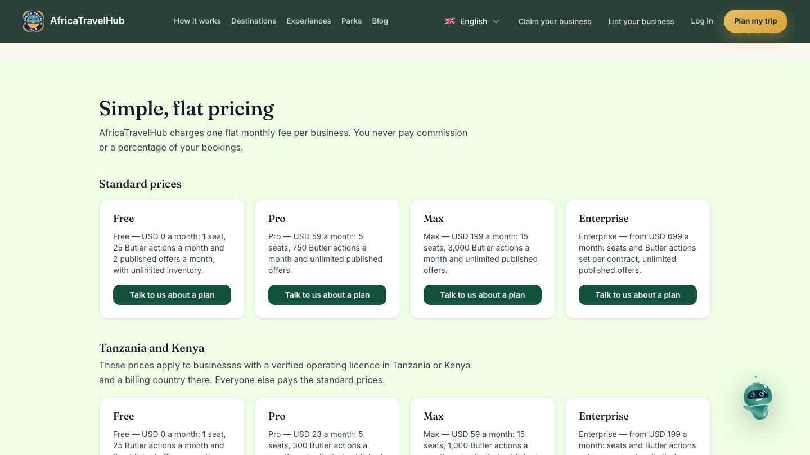
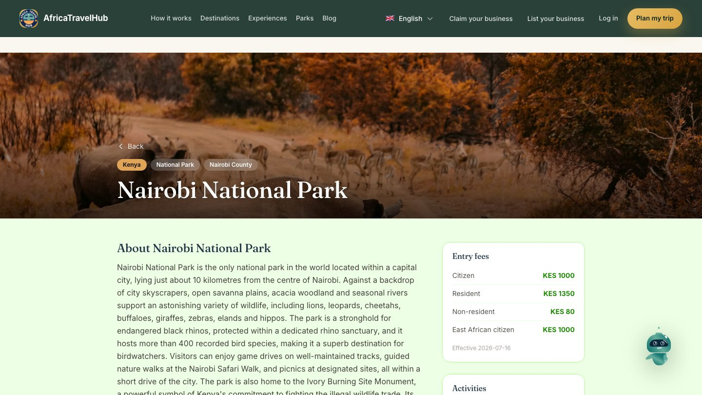

## Pages I worked on

**Pricing page.** Lays out the four flat monthly plans. I built it so the plans are clear to visitors and to search engines.

**Park page.** Each national park has its own page with entry fees and a description. I reworked these pages so they load quickly on phones and show up properly in search.

